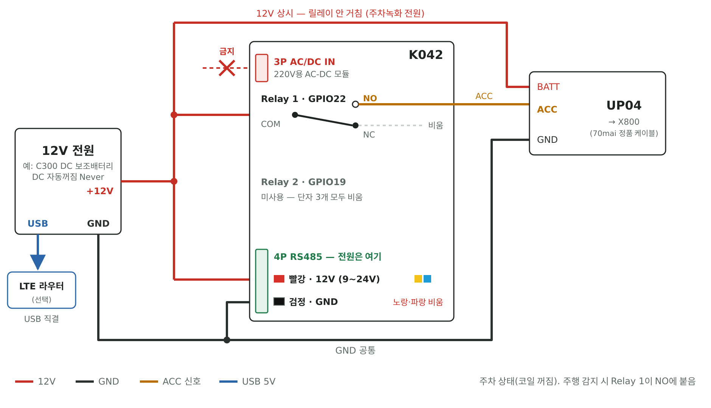

# Tesla 블랙박스 주차모드 자동 전환 — K042 + ESPHome + Tesla BLE

> VIN, 차량 BLE 이름·MAC, IP 대역, 도메인, 비밀번호 같은 값은 `<…>` 나 `192.168.X.Y` 같은 자리표시자로 바꿔 두었습니다. 자기 환경 값으로 채워 쓰세요.
>
> 기준: 2026-10 구축·실차 검증. 펌웨어는 실제로 차에서 돌고 있는 버전 그대로입니다.

| 파일 | 내용 |
|---|---|
| [`k042-x800.yaml`](k042-x800.yaml) | ESPHome 펌웨어 |
| [`secrets.example.yaml`](secrets.example.yaml) | `secrets.yaml` 템플릿 |
| [`k042-wiring.png`](k042-wiring.png) · [`k042-wiring.svg`](k042-wiring.svg) | 배선도 (PNG / 원본 SVG) |

---

## 1. 무엇을 만들었나

블랙박스(70mai X800)를 **하차하면 주차모드로, 타면 주행모드로** 자동 전환합니다.

- 블랙박스 하드와이어 키트(UP04)는 `ACC` 선에 12V가 있으면 주행모드, 0V면 주차모드로 동작합니다.
- 이 `ACC` 선을 **M5Stack K042 릴레이**로 켜고 끕니다.
- 켜고 끄는 판단은 K042의 ESP32가 **Tesla BLE 차량 키로 차에 직접 물어본 "차 안에 사람이 있는가(VCSEC User Present)"** 로 합니다.

```text
Tesla VCSEC ──BLE──> K042(ATOM Lite) ──Relay 1──> UP04 ACC ──> X800 주행/주차모드
                          ▲
   (선택) HA ──MQTT──────┘  "기어 D/R/N 이면 ON" 보조 신호만
```

### 왜 시거잭 전원으로 판단하지 않나
Model Y는 센트리·충전·공조 등으로 시거잭(12V 액세서리) 전원이 하차 후에도 살아 있을 수 있어 ACC 신호로 믿을 수 없습니다.
그래서 블랙박스 전원(BATT)은 따로 상시 공급하고, **ACC 선만** 릴레이로 만듭니다.

### 설계 원칙
1. **주 제어는 완전 로컬.** 인터넷·LTE·HA가 다 죽어도 BLE만으로 동작한다.
2. **통신이 끊겼다는 이유로 OFF하지 않는다.** OFF는 "차가 사람이 없다고 말했다"는 명시적 근거로만.
3. **실패 방향:** `주행 중 잘못 OFF  >>  주차 후 잠시 더 ON`. 애매하면 ON.
4. 기준은 "누가 운전하나"가 아니라 **"차에 누가 있나"**. 동승자가 먼저 내려도, 폰 없이 키카드로 타도 동작한다.
5. 차 안에 두는 장치에는 **최소 권한 키**(`CHARGING_MANAGER`)만 준다. 문 열기·주행 권한 없음.

---

## 2. 부품

| 부품 | 비고 |
|---|---|
| Tesla Model Y | |
| 70mai X800 + **UP04** 하드와이어 키트 | **UP04↔X800 케이블은 70mai 정품만** (7절 함정 참고) |
| M5Stack **ATOM HUB Switch K042 일반형** | ATOM Lite(ESP32-PICO-D4, PSRAM 없음) 포함, 2채널 릴레이, 9~24V DC 입력. K042-D·K402와 다름 |
| 12V 전원 | 저는 **Anker SOLIX C300 DC**(288Wh 인산철, 시거잭으로 충전·패스스루) 사용. 차량 상시 12V가 있으면 그걸로도 가능 |
| (선택) LTE 라우터 | 원격 모니터링용. 저는 GL.iNet Mudi V2(GL-E750V2), 배터리 제거·C300 USB 직결 |
| (선택) Home Assistant + MQTT | 모니터링과 보조 ON 신호용 |

---

## 3. 전원·배선

[](k042-wiring.png)

*배선도 — 주차 상태(릴레이 코일 꺼짐). 확대해도 깨지지 않는 원본은 [`k042-wiring.svg`](k042-wiring.svg). 같은 내용을 텍스트로 쓰면 아래와 같습니다.*

```text
12V(+) ─┬──> UP04 BATT                     (릴레이 거치지 않음 — 주차녹화 상시 전원)
        ├──> K042 RS485 단자 "빨강"(VCC_12V) ← K042 전원은 여기로만
        └──> K042 Relay 1 COM ──N.O.──> UP04 ACC
GND ────┬──> UP04 GND
        └──> K042 RS485 단자 "검정"(GND)
```

### 3.1 K042 전원 단자 — 가장 중요
K042 일반형에는 전원이 들어가는 단자가 두 개 있습니다. **12V DC는 4P RS485 단자로만** 넣으세요.

| 단자 | 실체 | 12V DC |
|---|---|---|
| 3P **AC/DC IN** | 220V AC→5V 모듈 입력 | **금지** |
| 4P **RS485** | SS24 역접 방지 → MP1584 강압 → 5V (9~24V) | **여기로** |

RS485 단자는 케이스 라벨의 색 띠가 핀 순서입니다(회로도 JP1과 일치).

| 색 띠 | 핀 | 신호 | 결선 |
|---|---|---|---|
| **검정** | 1 | GND | 12V GND |
| **빨강** | 2 | VCC_12V (9~24V) | 12V (+) |
| 노랑 | 3 | RS485 A | **비움** |
| 파랑 | 4 | RS485 B | **비움** |

- 라벨 옆 빨간 `9-24V → DC/DC → 5V@2A` 배지는 "빨강 단자로 들어온 전원이 DC/DC를 거친다"는 **기능 표시**입니다. 노랑·파랑 위치를 가리키는 게 아닙니다(실제로 한 번 헷갈렸습니다).
- **노랑·파랑(A/B)에 12V를 넣으면 안 됩니다.** SMAJ6.5CA TVS(6.5V)와 3.3V 트랜시버(SP3485)가 물려 있어 손상됩니다.

### 3.2 릴레이

| 릴레이 | GPIO | 접점 | 용도 |
|---|---|---|---|
| Relay 1 | **GPIO22** | **COM–N.O.** | UP04 ACC. HIGH = 코일 여자 = ACC 12V = 주행모드 |
| Relay 2 | GPIO19 | — | 미사용. 펌웨어에서 LOW 고정 |

- 회로도상 GPIO → 4.7kΩ → S8050 → 5V 코일, **HIGH = 여자**. 공식 예제(`SWITCH1 22`, `SWITCH2 19`)와 같습니다.
- 단자 순서는 케이스 스티커에 `N.O. / COM / N.C.`로 적혀 있습니다.
- **N.O.를 쓰는 이유:** 코일은 붙어 있는 동안 계속 전력을 먹습니다. 가장 오래 있는 상태(주차)에서 코일이 떨어져 있도록 N.O.를 씁니다.

### 3.3 하드웨어 참고
- ATOM Lite USB-C 전원만으로도 릴레이까지 동작합니다.
- ATOM을 USB로만 켠 채 K042에 꽂아 두면 부팅/다운로드 모드에서 GPIO가 떠서 릴레이가 딸깍거릴 수 있습니다. **처음 펌웨어를 구울 때는 ATOM Lite만 떼어서** 하는 게 편합니다.
- UP04 저전압 차단값: Low 11.8 / **Medium 12.0(기본)** / High 12.2 V. 쓰는 12V 전원 전압과 여유를 확인하세요.

---

## 4. 동작

### 4.1 판단 로직 (펌웨어 1초 주기)

| 조건 | 동작 | `ACC Reason` 표시 |
|---|---|---|
| VCSEC 탑승 감지 | 즉시 ON, OFF 대기 취소 | `ON present` |
| MQTT `ON` 수신 후 3분 이내 | ON 유지 (HA가 주행 중 1분마다 재전송) | `ON mqtt_hold` |
| VCSEC 값 없음(BLE 끊김 등) | **현재 상태 유지** — OFF 근거로 안 씀 | `HOLD_ON/HOLD_OFF vcsec_unavailable` |
| VCSEC 정상 + 탑승 없음 + 유지 끝 | 30초 뒤 OFF | `PENDING_OFF 30s` → `OFF absent_30s` |
| MQTT `OFF` | 탑승 중이면 **무시**(경고 로그), 아니면 즉시 OFF | `OFF mqtt` |
| 재부팅 | **ON으로 시작** — 주행 중 재부팅돼도 주차모드로 떨어지지 않게 | `ON boot` |
| `ACC Auto` 스위치 OFF | 자동 판단 정지, `Relay ACC`를 손으로만 (재부팅하면 자동 복귀) | — |

### 4.2 실측 (실차, MQTT 수신 시각 기준)

| 시험 | 조건 | 결과 |
|---|---|---|
| 하차 | 폰 들고 내려 잠그고 10 m 이상 이동 | User Present OFF까지 **약 45초~1분 45초** |
| 폰만 근처 | 폰 들고 잠긴 차 옆 1 m에 2분 | **계속 OFF** — 폰 근접만으로는 탑승 판정 안 함 |
| 폰 없이 탑승 | 폰 BT 끄고 키카드로 열고 운전석 | **약 3초** 만에 User Present ON |
| 종단 | 하차 → 릴레이 OFF → X800 주차모드 | 30초 타이머 포함 **하차 후 약 1분 15초~2분 15초** |
| 첫 실주행 26분 | | 탑승 후 0.4초에 릴레이 ON, 주행 중 MQTT·BLE 끊김 0, 재부팅 0, free heap 약 61 KB로 평탄 |

30초 타이머는 잠깐 내렸다 다시 타는 경우를 흡수하므로 굳이 줄이지 않았습니다.

### 4.3 상태 LED (ATOM Lite, 밝기 20%)

| 색 | 의미 |
|---|---|
| 빨강 깜빡임 | Wi-Fi 없음 |
| 노랑 | Wi-Fi OK, MQTT 안 됨 |
| 파랑 | MQTT OK, 차 데이터 없음 (BLE 미연결 또는 VCSEC 값 없음) |
| 보라 깜빡임 | 페어링 필요 |
| 초록 | 차에서 VCSEC 값을 받는 중 (정상) |

---

## 5. 네트워크 (선택 — 원격 모니터링을 원할 때)

ACC 전환 자체는 **네트워크가 전혀 필요 없습니다.** 아래는 집에서 상태를 보고, HA의 보조 ON 신호를 보내기 위한 구성입니다.

```text
HA (Mosquitto 애드온)
   ▲  브리지 — 허용 토픽만: tesla/x800/#, homeassistant/+/k042-x800/#
차량 전용 브로커 car-mqtt (순정 Mosquitto, 로컬 ACL)  192.168.X.Y:1883
   ▲  MQTT  (집 공유기 방화벽: WG 대역 → 브로커 tcp/1883 만 허용)
집 공유기 WireGuard 서버 (<ddns-host>:51820/udp)
   ▲  LTE
LTE 라우터 (WG 클라이언트, 분할 터널 — AllowedIPs = 브로커 /32 하나)
   ▲  Wi-Fi
K042
```

핵심 판단과 이유:

- **차량 장비를 HA 브로커에 직접 붙이지 않았습니다.** HAOS Mosquitto 애드온은 로그인되는 모든 계정이 슈퍼유저이고 ACL이 실제로 안 먹습니다(`acl_file`을 넣어도 로드만 되고 무효 — 실측). 그래서 순정 Mosquitto 브로커를 하나 따로 두고, **경계는 브리지 토픽 목록**으로 만들었습니다. 차에 둔 장비가 털려도 그 토픽 밖으로는 HA에 닿지 않습니다.
- `k042` 계정 ACL: `tesla/x800/#` 읽기·쓰기, `homeassistant/+/k042-x800/#` 쓰기만.
- **WireGuard 방화벽:** UniFi 등에서 VPN 존 기본정책이 Allow All일 수 있습니다. 브로커 1883만 허용 → 나머지 내부망·게이트웨이·외부 차단. 차에 WG 키가 저장되니 장치를 떼어 가도 브로커 1883 외에는 못 들어오게.
- **LTE 라우터는 분할 터널.** GL.iNet은 VPN 경로 모드를 **Route Mode / Auto Detect**로 두세요. Global Proxy면 AllowedIPs를 무시하고 전부 터널로 보내 외부 차단 규칙에 걸려 인터넷이 끊깁니다. Tesla·보조배터리의 일반 인터넷은 LTE로 바로 나갑니다.
- **MTU (중요):** LTE→WG 경로가 내부 1380 B 패킷도 통과 못 해서 차에서만 MQTT가 10초마다 끊겼습니다. 브로커 쪽에서 WG 대역으로 가는 경로에 MSS를 낮춰 해결:
  ```bash
  ip route replace <WG 대역>/24 via <브로커의 게이트웨이> mtu 1280 advmss 1240
  ```
  재부팅 후에도 남도록 systemd 서비스로 만들었고, **LXC 안에서는 `network-online.target`이 IPv4 주소를 안 기다려** 부팅 경합으로 실패했습니다. 서비스에 "게이트웨이 경로가 생길 때까지 최대 60초 대기 + `Restart=on-failure`"를 넣어 해결했습니다.
- 브로커 CT 메모리는 256 MB 이상. 128 MB에서는 dpkg가 OOM으로 죽어 자동 보안 업데이트가 실패했습니다.

---

## 6. 펌웨어

- 베이스: [`yoziru/esphome-tesla-ble`](https://github.com/yoziru/esphome-tesla-ble) **v2026.10.1 태그로 고정**, `tesla-ble-esp32-generic.dashboard.yml`(ATOM Lite = 클래식 ESP32 4MB)
- ESPHome 2026.9.0 이상 (패키지가 API 키 암호화 OTA를 씀)
- 빌드 결과 Flash 약 86.5%(1.59/1.79 MB), 차 연결 중 free heap 51~64 KB

### 6.1 `k042-x800.yaml`

전체 펌웨어는 [`k042-x800.yaml`](k042-x800.yaml)에 있습니다. 주석에 각 설정을 넣은 이유를 적어 두었습니다. 핵심만 보면:

- `tesla_ble_vehicle: role: CHARGING_MANAGER` — 최소 권한 키
- `api: reboot_timeout: 0s`, `mqtt: idf_send_async: true`, `discovery: false` — 7절 함정 2·3·5
- `interval: 1s` 람다 — 4.1절 판단 로직
- `interval: 60s` 람다 — 핵심 상태 retained 재발행
- `mqtt.broker` 는 자기 브로커 주소로 바꾸세요 (`192.168.X.Y`)

### 6.2 `secrets.yaml`

[`secrets.example.yaml`](secrets.example.yaml)을 `secrets.yaml`로 복사해 채웁니다.

- 차량 BLE MAC은 차 근처에서 BLE 스캐너로 찾습니다. 광고 이름은 `S` + VIN SHA1 앞 8바이트 hex + `C` 형태(예: `S1234abcd5678ef90C`)라 VIN으로 계산해 대조할 수 있습니다.

### 6.3 굽기
- 집 Wi-Fi 안에서는 OTA로 됩니다.
- **차 안에서는 OTA 불가** — WG가 차→집 1883 한 방향뿐이라서. 노트북 USB로 굽습니다(HA ESPHome → Install → Plug into this computer). Windows는 FTDI VCP 드라이버가 필요할 수 있습니다.

### 6.4 페어링
1. 차 옆에서 K042 전원을 넣고 LED가 **보라 깜빡임**(페어링 필요)인지 확인
2. HA의 `Car Pair BLE Key` 버튼(또는 `http://<K042 IP>` 웹서버의 버튼)
3. 키카드를 센터콘솔 리더에 대고 차 화면에서 승인
4. **판정은 USB 로그의 `[VCSEC Poll] Command completed successfully`로.** `Car Last Command`가 `Outcome unknown: Connection lost`여도 실제로는 성공한 경우가 있었습니다. 실패로 오해해 페어링을 여러 번 누르면 걸린 페어링이 조회를 막습니다 → 재부팅으로 풀림.
5. 성공하면 LED가 초록.

키 역할은 페어링 때 정해지므로, 바꾸려면 키를 지우고 다시 페어링해야 합니다. 참고로 차 키 목록에서 이 키를 지우려 했을 때 바로 삭제되지는 않았습니다(키카드 인증이 필요한 것으로 추정, 미확인).

---

## 7. 함정 모음 (실측으로 밟은 것)

대부분 **집에서는 멀쩡하고 차(LTE + WG + BLE 실연결)에서만** 터졌습니다. 재현 비용이 크니 처음부터 넣어 두길 권합니다.

| # | 증상 | 원인 | 해결 |
|---|---|---|---|
| 1 | Tesla 센서가 MQTT로 안 나감 | 컴포넌트가 엔티티를 스키마 검증 없이 만들어 `mqtt_id`가 없음(API 전용). YAML `id(...)`로도 "Couldn't find ID" | 템플릿 엔티티가 `App.get_binary_sensors()`에서 **이름**(`User Present`, `Asleep`, `Pairing Required`…)으로 원본을 찾아 미러링. 페어링 버튼도 `tesla_ble_vehicle.pair` 템플릿 버튼으로 |
| 2 | 차에서 15분마다 재부팅 | `api:` 기본 `reboot_timeout` 15분 — 차에선 HA API가 절대 안 닿음 | `api: reboot_timeout: 0s` |
| 3 | 차에서만 부팅 루프 | **Task WDT** — loopTask가 MQTT 락을 5초 넘게 기다림(USB 로그 `task_wdt … loopTask`) | `mqtt: idf_send_async: true` |
| 4 | 차에서만 MQTT 10초마다 끊김 (`Writing didn't complete`) | **MTU** — LTE→WG가 1380 B도 못 통과 | 브로커 쪽 `mtu 1280 advmss 1240` (5절). "패킷이 작아서 MTU 아님"이라고 오판했었음 — RST의 seq와 브로커가 받은 바이트 수를 비교해 확정 |
| 5 | 탑승 값이 HA에 안 옴 (`Dropped N messages`) | `idf_send_async` 큐가 **30개 고정**. 접속 직후 discovery ~27 + 상태 ~27이 LTE에서 넘침. 바이너리 센서는 값이 바뀔 때만 재발행 | `discovery: false`, 핵심 상태 **60초마다 retained 재발행**, `logger.logs.component: ERROR` |
| 6 | discovery를 끄면 새 엔티티 추가는? | | 집에서 잠깐 `discovery: true`로 굽거나, HA에서 `homeassistant/<comp>/<node>/<obj>/config`를 retained로 직접 publish |
| 7 | 페어링 실패처럼 보임 | `Last Command` 표시가 부정확 | USB 로그로 판정 (6.4) |
| 8 | ACC를 꺼도 X800이 주차모드로 안 감, 앱에 "주차 감시 케이블이 감지되지 않습니다" | **UP04↔X800 비정품 케이블** — 전원만 되고 ACC 신호선이 없음 | **70mai 정품 케이블**로 교체 |
| 9 | Wi-Fi가 끊기면 BLE도 재연결 안 됨 | 패키지가 Wi-Fi 끊김 시 BLE 스캔을 멈춤 | 차에서는 LTE 라우터 Wi-Fi 필수. 끊겨도 펌웨어는 HOLD(현재 상태 유지)라 주행 중엔 안전 |
| 10 | HA 웹소켓으로 엔티티와 **같은 토픽**을 `mqtt/subscribe`하면 그 엔티티가 값을 버림 (`Invalid undecoded state message`) | HA 동작 | 디버깅 구독은 와일드카드나 `mosquitto_sub`로 |

문제 구간을 가를 때: `ACC Auto` OFF → `Relay ACC`를 HA에서 직접 OFF → UP04 ACC 0 V 측정 → 카메라 반응. 이러면 K042 쪽 문제인지 카메라 쪽 문제인지 갈립니다.

---

## 8. HA 연동 (선택)

### 8.1 보조 ON — TeslaMate 기어

VCSEC와 **고장 지점이 다른** 백업 경로입니다. TeslaMate가 기어 D/R/N을 보이면 K042에 ON을 보냅니다. K042는 ON을 받으면 3분 유지하므로 주행 중에는 1분마다 재전송합니다. **켜는 쪽에만** 씁니다(기어 값이 끊겨도 주행 중 OFF가 되지 않게).

```yaml
alias: 주행 시 K042 ACC 유지
description: >-
  TeslaMate 기어가 D/R/N 이면 K042 에 ACC ON 을 보낸다. K042 는 3분 유지하므로
  주행 중 1분마다 재전송. retain 은 반드시 false — 남아 있으면 K042 재접속 때 주차 중에도 ON 이 된다.
triggers:
  - trigger: state
    entity_id: sensor.<car>_shift_state
    to: [D, R, N]
  - trigger: time_pattern
    minutes: /1
conditions:
  - condition: state
    entity_id: sensor.<car>_shift_state
    state: [D, R, N]
actions:
  - action: mqtt.publish
    data:
      topic: tesla/x800/acc/set
      payload: "ON"
      qos: 1
      retain: false
mode: single
max_exceeded: silent
```

- BLE로 기어를 직접 읽는 안은 기각했습니다. VCSEC와 같은 BLE 링크라 고장 지점이 같고, 라이브러리가 주행 중에도 인포테인먼트를 약 60초 간격으로만 조회합니다(`Car Shift State`는 관찰용으로만 남김 — 실제로 TeslaMate보다 약 1분 늦음).
- 알려진 위험: TeslaMate 값이 D에 멈춰 있으면 주차 중에도 ON이 계속 갑니다(애매하면 ON 방향의 실패라 허용).

### 8.2 MQTT 토픽

| 토픽 | 방향 | 내용 |
|---|---|---|
| `tesla/x800/acc/set` | HA → K042 | `ON` / `OFF` |
| `tesla/x800/k042/switch/relay_acc/state` | K042 → HA | 릴레이 상태 (retained) |
| `tesla/x800/k042/sensor/acc_reason/state` | K042 → HA | 마지막 판단 근거 |
| `tesla/x800/k042/status` | K042 → HA | LWT `online`/`offline` |
| `tesla/x800/k042/debug` | K042 → HA | WARN 이상 로그 (무시한 MQTT OFF 포함) |

### 8.3 유용한 엔티티
`binary_sensor.k042_x800_car_user_present`, `…_car_asleep`, `…_car_ble_connected`, `switch.k042_x800_relay_acc`, `switch.k042_x800_acc_auto`, `sensor.k042_x800_acc_reason`, `sensor.k042_x800_free_heap`, `text_sensor` `Reset Reason`.

---

## 9. 장애 상황별 동작

| 상황 | 동작 |
|---|---|
| 정상 탑승 | VCSEC로 약 3초 안에 ON |
| 동승자 먼저 하차 | 운전석에 사람이 있는 한 VCSEC가 탑승 → ON 유지 |
| 폰 없이 키카드로 탑승 | VCSEC로 ON (폰 무관) |
| LTE·WG·MQTT·HA 장애 | **로컬 제어 정상** — K042가 VCSEC만으로 판단. 집에서는 `unavailable`로 보이고, HA에 찍힌 릴레이 변경 시각은 재접속 시각이지 실제 전환 시각이 아님 |
| ↳ 그 사이 BLE까지 끊김 | VCSEC를 모름 → **현재 상태 유지**. 주행 중이면 ON이라 안전, 하차 뒤라면 주차모드 전환이 늦어짐 |
| 주행 중 인터넷 단절 | ON 유지 |
| HA가 늦게 OFF (재탑승 직후) | 탑승 중이면 무시 |
| 센트리 ON | ACC만 OFF → 주차모드 (센트리와 무관) |
| K042 재부팅 | ON으로 시작 → VCSEC가 "없음"이면 30초 뒤 OFF |
| 12V 전원(보조배터리) 자동 꺼짐 | **전부 정지.** 보조배터리 DC 출력 자동 꺼짐은 반드시 **Never** |

---

## 10. 알려진 이슈

- **BLE 재연결이 차를 깨울 수 있음.** 컴포넌트 `handle_connection_established()`가 연결될 때마다 `infotainment_poll(WAKE_IF_NEEDED)`를 부르고, 차가 자고 있으면 tesla-ble가 `RKE_ACTION_WAKE_VEHICLE`를 보냅니다(설정으로 못 끔). 밤에 BLE가 끊겼다 붙을 때 차가 깨어 약 15분 뒤 다시 자는 것을 하룻밤 2회 봤습니다. 대책 후보는 로컬 포크에서 `NO_WAKE_SKIP`으로 바꾸는 것(미적용). 주기 조회 자체는 연결 60초 뒤나 차가 자는 걸로 보이면 `NO_WAKE_SKIP`이라 깨우지 않습니다.
  - 주의: 차가 "혼자" 깨면 K042부터 의심하지 말고, **HA 자동화(예: 애프터블로우·공조) 트레이스부터** 보세요. 저는 처음에 오판했습니다. K042 탓인지는 깸 직전에 BLE 재연결이 있었는지로 가릅니다.
- 인포테인먼트 서명 오류 `ERROR_TIME_EXPIRED` — ATOM에 시계 동기화가 없어서(`time: homeassistant`는 API 전용). 기어 등 인포테인먼트 값을 판단에 쓰려면 SNTP를 추가하세요. VCSEC 탑승 감지에는 영향 없음.
- 확인 못 한 것: 차가 깨어 있고 **잠기지 않은** 상태에서 폰만 근처에 있을 때의 오판 여부, 깊은 지하주차장 BLE 품질, 며칠 단위 장기 안정성.

---

## 11. 보안

- K042의 Tesla 키는 `CHARGING_MANAGER` — 패키지 기본값 `DRIVER`(잠금 해제·주행 가능)를 반드시 덮어쓰세요.
- 차에 두는 장비가 가진 비밀은 "브로커 1883에 들어가 자기 토픽만 쓸 수 있는 권한"뿐이 되도록.
- 장비 분실·도난 시 철회 순서: 공유기 WG 피어 삭제 → 브로커 계정 삭제(`mosquitto_passwd -D`) → LTE 라우터 클라우드 바인딩 해제 → Tesla 키 목록에서 K042 키 삭제.
- 웹서버(`web_server`)는 인증을 걸어 두었습니다. 차 안 비상용으로 폰을 LTE 라우터 Wi-Fi에 붙이면 `http://<K042 IP>`에서 페어링 버튼과 탑승 값을 볼 수 있습니다.

---

## 참고
- [yoziru/esphome-tesla-ble](https://github.com/yoziru/esphome-tesla-ble)
- M5Stack ATOM HUB Switch K042 공식 문서·회로도
- FOSDEM 2025 — Tesla BLE / ESPHome 발표
